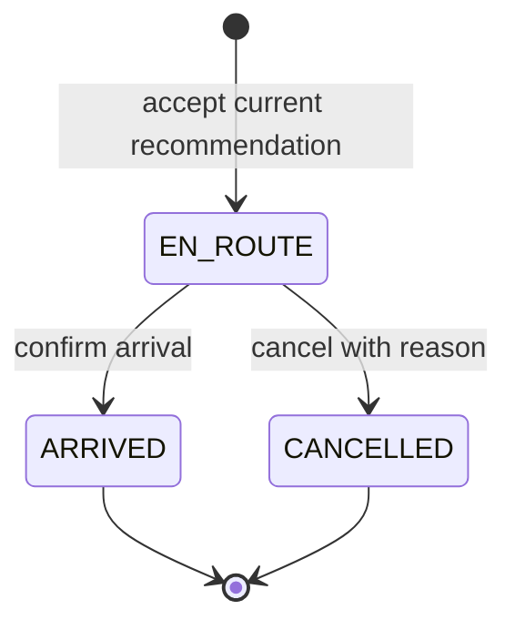

# Durable fleet operations

The fleet workflow uses a persistent dispatch ID from acceptance through arrival or cancellation. Assignment, truck status, coverage, observation and audit writes commit in one SQLite transaction. It preserves the authenticated municipality boundaries described in [AUTHENTICATION.md](AUTHENTICATION.md).

## Run and migrate

Before starting an updated backend, back up the operational/control databases and run:

```bash
cd /workspace/nagarflow
venv/bin/python scripts/prepare_dev.py
```

This migrates **all provisioned municipalities**, including inactive ones, without creating accounts. Run it before Gunicorn as well as local startup. Repeat runs preserve dispatch history. All application processes for a municipality must use the same persistent database file. SQLite serializes writers with `BEGIN IMMEDIATE`; this design is for a single persistent host, not independently replicated local databases.

Legacy trucks with `en_route_to_...` status are imported as active dispatches. Their acceptance time, actor and prediction score remain unknown. Duplicate legacy routes are retained as legacy records; new acceptance is blocked while a zone has any active route. Unknown legacy destinations must be cancelled and corrected before redispatch. Previously seeded visit timestamps and unlinked historical prediction outcomes remain stored, but do not count as confirmed evidence in the new reports.

## Operator flow

1. Open `/dispatch` or `/dashboard` as an administrator. Suggestions identify the prediction snapshot and a compatible idle vehicle. They exclude active zones and already-serviced recommendation versions. Garbage trucks serve garbage complaints and water tankers serve water-supply complaints. Road, drainage and unclassified needs require maintenance crews or classification; they are not assigned a substitute vehicle.
2. Accept a suggestion. The server rechecks that both vehicle and zone are available and that the recommendation has not changed. A stale page cannot overwrite a busy route.
3. Use **Active assignments** to confirm arrival at that assignment's destination, or cancel it with a reason. Both pages display the same server records. Refreshing a page preserves the assignment.
4. Arrival releases the vehicle, records its destination coordinates and updates confirmed coverage. An optional operator demand score (0–100) and notes can be recorded. An omitted score creates no demand observation. Cancellation releases the vehicle and records the reason; it records no arrival, coverage or observation.

Arrival is an **operator confirmation**, not GPS verification or approval of maintenance work. The supervisor/worker task workflow remains separate: assign a team, let its worker upload task-bound evidence, then approve that submitted evidence. The supervisor UI no longer offers a completion action before evidence is submitted.

## State transitions



Terminal records cannot be edited by retrying a mutation. A cancelled recommendation can be accepted again with a **new** key. An arrived recommendation is not offered again until its prediction version changes. An old arrival/cancellation replay never releases a vehicle from a newer assignment.

## API contract

All routes require an administrator session. Writes also require `X-CSRF-Token` and an `Idempotency-Key` containing 16–128 ASCII letters, digits, underscores or hyphens. Use a fresh random UUID for each logical action; retain it when retrying an uncertain response. Do not reuse a key for different details. The frontend holds pending keys in memory; no credentials or role authority are stored with them.

| Route | Purpose |
| --- | --- |
| `GET /api/dispatch` | Current suggestions, including `prediction_id` and `prediction_version` |
| `GET /api/dispatch/assignments` | All active dispatches and up to 100 recently closed records |
| `POST /api/dispatch/accept` | `{ "truck_id": 1, "zone": "Dharavi", "prediction_id": 7, "prediction_version": "<64-character version from feed>" }` |
| `POST /api/dispatch/arrive` | `{ "dispatch_id": "<32-character ID>", "actual_demand": 65, "notes": "Operator report" }`; score/notes optional |
| `POST /api/dispatch/cancel` | `{ "dispatch_id": "<32-character ID>", "reason": "Vehicle needs inspection" }` |

Success returns `{ "success": true, "dispatch": {...}, "replayed": false }`. A valid replay returns the **current** dispatch state with `replayed: true`, even if the assignment has since closed. A duplicate accept for the same active vehicle/recommendation also resolves to the existing record. Repeating a closure with the same details does not add visits, observations or events. A different observation/reason for an already closed record returns a conflict.

These payloads replace the prototype API: accepting with only a truck/zone or arriving with only a truck/zone is rejected. Deploy the frontend and backend changes together and migrate external clients. The API never guesses which active route an old request intended.

Validation failures return 400; missing/foreign municipality records return 404; stale recommendations, busy assets, incompatible vehicles, missing verified coordinates and terminal-state conflicts return 409 with a stable `code`. Missing sessions return 401; roles/CSRF failures return 403. Storage failures return 503 and roll back the transaction. Failed attempts do not consume a successful idempotency entry. Keep histories and request keys together when backing up or implementing retention.

`dispatches` stores the immutable recommendation/vehicle/destination snapshot plus lifecycle timestamps and actors. Partial unique indexes prevent multiple active assignments to the same vehicle or new zone, and prevent reusing a serviced prediction version. `dispatch_requests` binds operation/key to a payload fingerprint and dispatch. `dispatch_events` records committed accept/arrival/cancellation events in the same transaction. Auth account events remain in the control database.

## Reporting

`GET /api/reports`, the dashboard and downloadable report now distinguish missing data from measurements:

- Coverage is the fraction of known zones with an operator-confirmed arrival or evidence-approved task in the last 48 hours. Seeded legacy coverage timestamps are excluded. An empty municipality reports unavailable coverage.
- Demand comparisons require an explicitly supplied operator score linked to a non-legacy dispatch and its acceptance-time priority snapshot. Synthetic/unlinked outcomes are excluded and counted. Empty days have no score value; reports do not invent weekly trends or ward statistics.
- A priority score and an operator demand score are operational proxies. Their absolute difference is shown in **score points**, not advertised as forecast accuracy. Prediction accuracy, equity and fleet efficiency remain unavailable until their definitions and data are validated. Automatic model-retraining claims/actions have been removed from the reports.
- PDF export uses the current report data and includes definitions and limitations. The prototype's decorative report download tiles have been removed.

Optional development fleet animation updates coordinates only. It cannot confirm arrival, release a vehicle or record observations. The production dashboard no longer exposes the surge mutation; `/api/simulate-surge` is disabled by default. What-if simulation remains separate from authoritative dispatch state.

## Verification and remaining work

The backend suite exercises concurrent accepts, duplicate requests, arrival/cancel races, failed-write rollback, stale predictions, type/coordinate validation, legacy migration, municipality/role isolation and truthful reporting. Browser checks cover both dispatch entry points, acceptance without the external map script, arrival with and without observations, cancellation/reacceptance, reload persistence, stale-suggestion feedback, PDF export and the supervisor-to-worker approval flow.

This milestone does not implement durable provider ingestion, full mutation validation outside dispatch, audited observation corrections, automatic route optimization, GPS telemetry or evaluated forecasting/retrieval. Those remain in [PRODUCT_ROADMAP.md](PRODUCT_ROADMAP.md).
