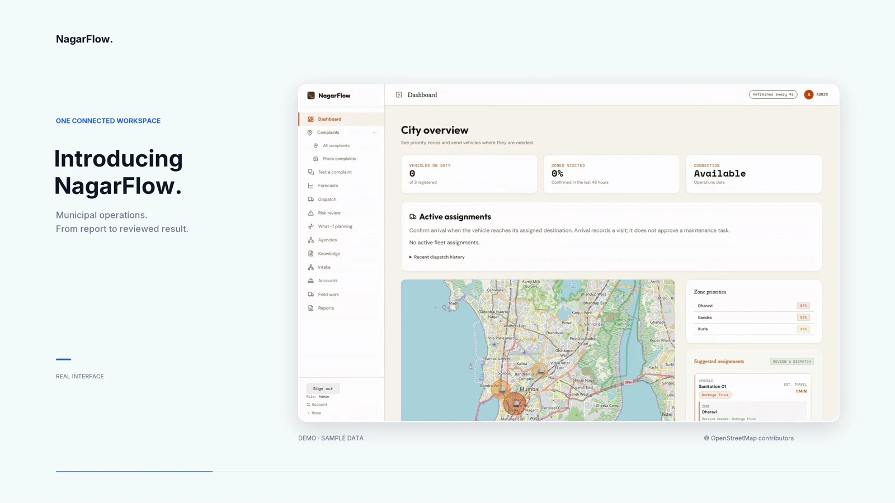
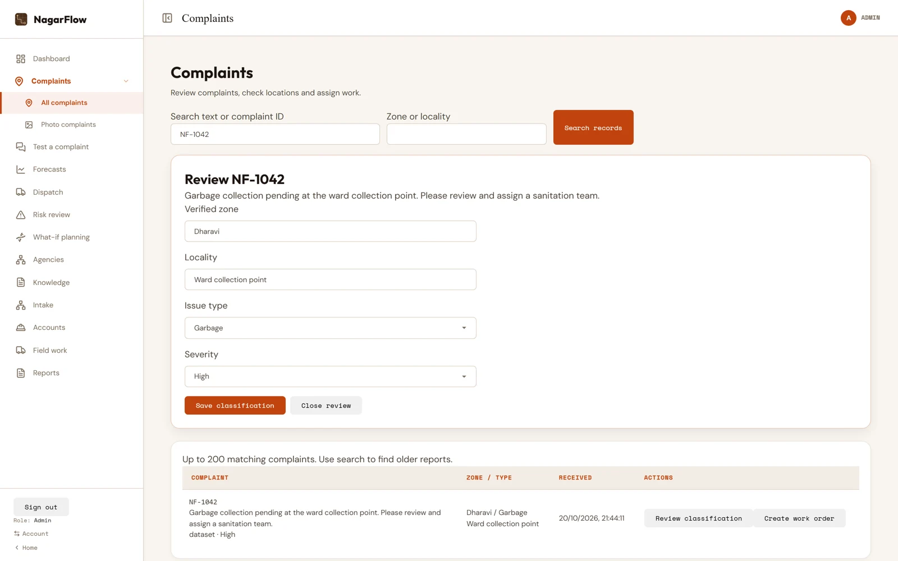
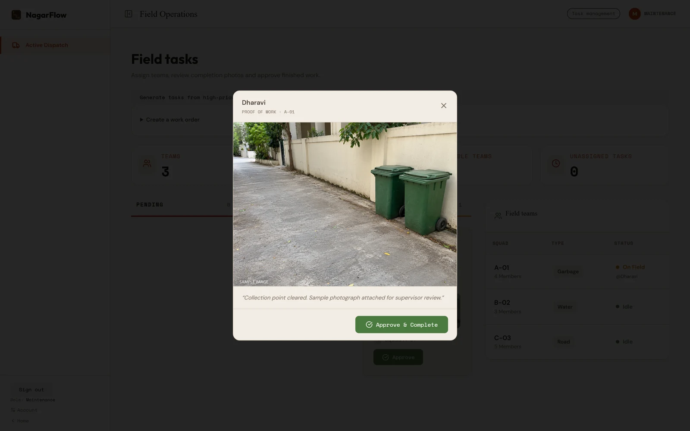
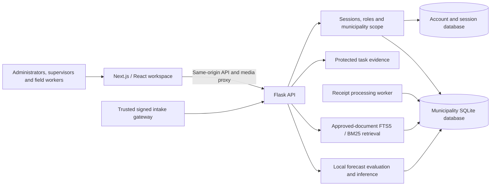

<div align="center">

# NagarFlow

### Turning complaints into accountable action.

One connected workspace for municipal complaint review, work orders, resource coordination and verified field completion.

[](https://github.com/vinitgirdhar/nagarflow/actions/workflows/ci.yml)


[Explore the prototype](https://nagarflow.netlify.app) · [Watch the film](nagarflow-next/public/media/nagarflow-product-film.mp4?raw=true) · [Run locally](#run-locally) · [Demo walkthrough](#demo-walkthrough) · [Documentation](#documentation)

</div>

## The idea

**A complaint is not resolved when it is received. It is resolved when the work is verified.**

Municipal teams need more than an inbox. A report must reach the right team, become an actionable work order and return with evidence someone can review. When those steps live in separate systems, responsibility and progress become difficult to follow.

NagarFlow connects those steps for administrators, maintenance supervisors and field workers. Complaint review, crew assignments, vehicle dispatch, completion photographs and supervisor approval sit alongside planning forecasts and searchable approved guidance.

**Report → Review → Assign → Submit evidence → Verify**

## Product film

[](nagarflow-next/public/media/nagarflow-product-film.mp4?raw=true)

**[Watch or download the 45-second film](nagarflow-next/public/media/nagarflow-product-film.mp4?raw=true)** · [English captions](nagarflow-next/public/media/nagarflow-product-film.vtt)

The linked poster opens the MP4 from the repository. The landing page also includes an embedded player with captions and fullscreen controls. The film records the actual application using labeled sample data; its sample evidence image and Indian English narration are synthetic.

## What makes NagarFlow different

- **Completion has an approval step.** A field submission is not automatically treated as verified work. A supervisor reviews the evidence before approving completion.
- **Responsibility stays connected to the report.** Work orders can reference their source complaint, while team assignments and dispatch decisions record who acted.
- **Planning supports the operator.** Forecasts, priority records and vehicle suggestions inform decisions. People approve assignments and completed work.
- **Guidance comes with sources.** Document search retrieves approved excerpts with citations and withholds an answer when relevant evidence is missing.

## Features

| Capability | What is implemented |
| --- | --- |
| Complaint review | Search by text, ID or location; review zone, locality, service category and severity; save classifications with revision checks. |
| Work orders | Create tasks directly or from reviewed complaints, retain the source complaint and avoid duplicate active orders for the same report. |
| Team coordination | Inspect availability and service specialization, assign crews and follow pending, in-progress and submitted work. |
| Fleet dispatch | Register vehicles, review compatible suggestions, accept assignments and explicitly confirm arrival or cancellation. Stored map positions are separate from live GPS tracking. |
| Field worker workspace | Open assigned tasks on mobile, start work, upload task-bound photographs and submit field notes for verification. |
| Supervisor verification | Inspect completion photographs and notes, then approve finished work. Workers cannot approve their own submissions. |
| Knowledge workspace | Add document drafts, approve or retire them, search exact excerpts and inspect citations. Unapproved text is excluded from retrieval. |
| Demand forecasts | Compare weekly seasonal, rolling-mean and ridge-regression models; display two-day complaint-volume estimates and data-readiness states. |
| What-if planning | Explore deterministic changes to a copy of priority scores without changing operational records. |
| Reports | Review confirmed visits and explicit observations, record audited corrections and export current-data PDF reports. |
| Intake operations | Inspect signed gateway receipts, processing status, review queues, retries and dead letters. Repeated deliveries are deduplicated. |
| Risk and agency context | Review available weather/AQI snapshots with source and freshness information; consult the agency directory. |
| Workspace access | Server-side sessions, CSRF protection, role permissions, account/team management and municipality-scoped data and media. |
| Operational tooling | Health checks, request IDs, privacy-conscious application logs, backup/restore tools and optional authenticator MFA with recovery codes. |

### Roles

| Role | Main responsibilities |
| --- | --- |
| Administrator | Review complaints, create work orders, manage accounts/resources, approve dispatches and inspect knowledge, forecasts and reports. |
| Maintenance supervisor | Assign field teams, monitor tasks, review submitted photographs and approve completion. |
| Field worker | View their team's tasks, start work and submit photographs and notes for review. |

Permissions are enforced by the API. A browser control cannot grant a role or select another municipality's records.

## Product views

**Review a complaint before assigning work.**



**Inspect field evidence before approving completion.**



These application screens use fictional records. The photograph marked “SAMPLE IMAGE” demonstrates the evidence workflow; it is not proof of municipal work.

## Demo walkthrough

Open the [prototype sign-in page](https://nagarflow.netlify.app/login). When public demo access is enabled, it displays sample accounts for Administrator, Supervisor and Field worker. These are distinct authenticated accounts in a shared synthetic municipality.

1. **Review a complaint.** As Administrator, open Complaints, inspect a sample report and confirm its location and category.
2. **Create a work order.** Create a linked task from the complaint, then open Field work.
3. **Assign responsibility.** As Supervisor, select an available team. Separately, use Administrator access to review and accept an appropriate vehicle dispatch.
4. **Submit evidence.** As the assigned Field worker, open the task, upload a sample photograph and add completion notes. Submit it for verification.
5. **Verify the result.** Return as Supervisor, open the submitted evidence and approve completion after review.
6. **Show decision support.** As Administrator, search an approved document and open its citation. Explore Forecasts when sufficient recent history is available.

Vehicle arrival records a visit; it does not approve a field task. The public sample is shared between visitors, so available records and assignments can change. Use disposable sample data for demonstrations.

The public Field worker is tied to the sample field team. Use that team's assigned task for the evidence/approval steps, or provision a worker for the selected team when demonstrating a new report from start to finish. See [account and team provisioning](docs/AUTHENTICATION.md).

### Prototype status

The hosted prototype uses **Netlify for Next.js and Render Free for Flask and the worker**. The free backend can sleep, and its local files can reset on sleep, restart or redeployment. Accounts, sample changes and uploaded evidence are not durable municipal records on this hosting configuration. See [hosting behavior](docs/RENDER.md).

The repository implements the workflows above. It does not establish municipal adoption, field-validated forecast accuracy, autonomous emergency response or live vehicle GPS tracking. Provider integrations require separate configuration and live validation. The public prototype disables MFA prompts; MFA remains an optional deployment capability.

## Architecture



Gateway intake first stores a receipt. The worker processes each receipt and its complaint changes transactionally, with retry and deduplication guards. Browser requests use the frontend's origin, and the backend selects the municipality from the authenticated account.

### Technology

| Layer | Stack |
| --- | --- |
| Web application | Next.js 16, React 19, TypeScript, CSS Modules, Framer Motion, Lucide icons |
| Backend | Python, Flask, Werkzeug, Gunicorn |
| Storage | SQLite, municipality-specific databases and protected local media |
| Document retrieval | SQLite FTS5/BM25 with approved-only excerpts and citations |
| Forecasting | Standard-library weekly seasonal baseline, seven-day mean and fitted ridge lag regression |
| Maps and exports | Leaflet, OpenStreetMap, jsPDF and jsPDF AutoTable |
| Verification | Python unittest, Playwright, ESLint, TypeScript and GitHub Actions |
| Hosting configuration | Netlify Next.js runtime plus a Render Docker backend and worker |

OpenStreetMap attribution is preserved wherever maps appear. Live voice, language, image-provider and weather integrations are optional. Core account, work-order, dispatch, retrieval and local forecasting workflows do not require paid-provider keys.

## Run locally

**Prerequisites:** Python 3.12, Node.js 22 with npm, Git and SQLite with FTS5 support. Use the `main` branch.

### macOS, Linux or Windows with WSL

```bash
git clone --branch main https://github.com/vinitgirdhar/nagarflow.git
cd nagarflow
bash scripts/setup_cloud.sh
venv/bin/python -m scripts.admin.manage_users create --email you@example.org --name 'Municipality administrator'
```

Replace the example email with your administrator's address. The account command privately prompts for a temporary passphrase. Sign in and change it on first use. Private accounts have no default password.

Start the backend from the repository root:

```bash
NAGARFLOW_COOKIE_SECURE=false venv/bin/python -m backend
```

In a second terminal, from the repository root:

```bash
cd nagarflow-next
npm run dev -- --hostname 127.0.0.1
```

Open **http://127.0.0.1:3000**. Keep both terminals running. The frontend forwards `/api/*` and `/uploads/*` to Flask on port 5000; the development backend also starts the intake worker.

<details>
<summary>Native Windows / PowerShell setup</summary>

From a fresh clone's repository root:

```powershell
py -3.12 -m venv venv
.\venv\Scripts\python.exe -m pip install -r backend/requirements.txt
npm --prefix nagarflow-next ci
.\venv\Scripts\python.exe -m scripts.admin.prepare_dev
.\venv\Scripts\python.exe -m scripts.admin.manage_users create --email you@example.org --name "Municipality administrator"
$env:NAGARFLOW_COOKIE_SECURE="false"
.\venv\Scripts\python.exe -m backend
```

In another PowerShell terminal, from the repository root:

```powershell
cd nagarflow-next
npm run dev -- --hostname 127.0.0.1
```

</details>

Check API readiness with `curl http://127.0.0.1:5000/api/health`; the ready response is `{"status":"ok"}`. Stop an older instance if its port is occupied. A server on a remote machine requires that machine's forwarded address rather than your own localhost.

Setup migrates existing stores without automatically importing synthetic history. Follow [Authentication and workspace access](docs/AUTHENTICATION.md) for sample-data and public-demo provisioning. Keep secrets, account stores, evidence, backups and MFA keys outside version control. `NAGARFLOW_COOKIE_SECURE=false` is for local HTTP; production requires secure cookies.

### Configuration

| Setting | Purpose |
| --- | --- |
| `NAGARFLOW_BACKEND_URL` | Next.js server's backend origin; defaults to local port 5000. Netlify requires the real external HTTPS backend origin. |
| `NAGARFLOW_COOKIE_SECURE` | Local HTTP cookie setting; production forces secure cookies. |
| `NAGARFLOW_DB_PATH`, `NAGARFLOW_AUTH_DB`, `NAGARFLOW_TENANT_DATA_DIR` | Operational, account/session and municipality storage locations. |
| `NAGARFLOW_TRUSTED_ORIGINS` | Exact permitted frontend origins for authenticated requests. |
| `NAGARFLOW_DEMO_ENABLED` | Explicitly enables the separate public synthetic workspace. |
| `NAGARFLOW_MFA_ENABLED`, `NAGARFLOW_REQUIRE_ADMIN_MFA` | Optional authenticator and administrator enrollment policy. |
| `NAGARFLOW_WEBHOOK_SECRET` | Private shared secret for normalized, signed gateway intake. |

See [Operations](docs/OPERATIONS.md) and [Deployment](docs/DEPLOYMENT.md) for provider settings, worker supervision and private storage. Credentials belong on the backend, never in frontend source or `NEXT_PUBLIC_*` variables.

## Verification and evaluation

From the repository root, using Bash/WSL:

```bash
venv/bin/python -m unittest discover -s backend/tests -t .
venv/bin/python -m scripts.evaluation.evaluate_intelligence
venv/bin/python -m scripts.admin.preflight
cd nagarflow-next
npm run test:deployment
npm run test:auth
npm run build
npx playwright install chromium
CI=1 npm run test:e2e
```

The [GitHub Actions workflow](.github/workflows/ci.yml) runs backend tests, intelligence evaluation, frontend configuration/auth checks, the production build and browser journeys. Tests use isolated synthetic fixtures. Check [Actions](https://github.com/vinitgirdhar/nagarflow/actions) for the result of the commit you are reviewing.

**Interpreting intelligence results:** retrieval is extractive lexical search, not open-ended generative AI. Forecasts compare baselines and fitted regression using rolling-origin historical checks. Model selection and reported backtest errors are not independent holdout validation. Sparse or stale histories withhold forecasts, and residual ranges are not calibrated confidence intervals. [Evaluation methodology](docs/EVALUATION.md) documents the synthetic fixtures and measured limits.

## Repository guide

See [Project structure](docs/PROJECT_STRUCTURE.md) for ownership boundaries and commands. Run Python entrypoints as modules from the repository root; runtime stores and credentials remain private and ignored.

```text
backend/
  api/                    Product API blueprint
  auth/                   Sessions, roles, MFA and public prototype accounts
  core/                   Storage, migrations, privacy, logs and backups
  intake/                 Complaint parsing, locality matching and receipt worker
  operations/             Fleet, assignments, work orders and reports
  intelligence/           Forecasting, knowledge retrieval and priority scoring
  integrations/           Agency, speech and weather providers
  static/                 Backend-served assets
  tests/                  Backend, CLI and deployment regression checks
  app.py                  Flask application; start with python -m backend
  requirements.txt        Python runtime dependencies
nagarflow-next/
  app/                    Next.js pages, components and typed API helpers
  public/media/           Web film, poster and English captions
  e2e/                    Browser journeys
  tests/                  Frontend configuration and authentication checks
scripts/
  admin/                  Accounts, migrations, readiness and backup commands
  deployment/             Production supervisor and initial administrator setup
  dev/                    Isolated browser fixtures and explicit sample seeders
  diagnostics/            Manual inspection utilities
  evaluation/             Reproducible intelligence evaluation
  integrations/           Provider polling commands
  data/                   Explicit historical complaint import
  legacy/                 Historical optional-provider diagnostics
  run_worker.py           Worker command; run as a module
  setup_cloud.sh          Local setup
  start_production.sh     Production service commands
data/                     Bundled synthetic datasets and locality reference
media/launch-film/        Finished 4K film, poster, captions and production notes
docs/                     Product, operations, deployment guides and screenshots
```

## Deployment

- **Current prototype:** deploy the Next.js frontend with the root [Netlify configuration](netlify.toml) and the backend/worker with the free [Render Blueprint](render.yaml). Follow [NETLIFY.md](docs/NETLIFY.md) and [RENDER.md](docs/RENDER.md). Free-host files are disposable.
- **Durable deployment:** a combined frontend/API/worker [Dockerfile](Dockerfile) and [deployment runbook](docs/DEPLOYMENT.md) are also included. Establish persistent private storage, HTTPS, account provisioning, backup/restore drills and operator acceptance on the target host.

The Netlify build uses the native Next.js runtime. This authenticated application is not a static export. Set the actual backend HTTPS origin before building, and trust the exact frontend origin on the backend.

## Roadmap

The connected complaint-to-verification workflow, scoped accounts, grounded retrieval, forecast comparison and operational tooling are implemented. Next priorities are representative municipal field evaluation, durable hosted operations, forecast uncertainty calibration, broader human-reviewed retrieval evaluation and organization-specific access/retention requirements.

See the [product roadmap](docs/PRODUCT_ROADMAP.md) for external launch gates and the [implementation report](docs/IMPLEMENTATION_REPORT.md) for supporting evidence.

## Documentation

| Guide | Contents |
| --- | --- |
| [Authentication](docs/AUTHENTICATION.md) | Roles, public sample accounts, municipality isolation and optional MFA |
| [Dispatch](docs/DISPATCH.md) | Acceptance, arrival, cancellation and observation handling |
| [Operations](docs/OPERATIONS.md) | Signed intake, worker retries, retrieval, forecasts and monitoring |
| [Evaluation](docs/EVALUATION.md) | Synthetic fixtures, model comparisons and interpretation limits |
| [Deployment](docs/DEPLOYMENT.md) | Production requirements, backups and recovery |
| [Netlify](docs/NETLIFY.md) / [Render](docs/RENDER.md) | Frontend/backend deployment and free-host behavior |
| [Implementation report](docs/IMPLEMENTATION_REPORT.md) | Implemented work and verification record |
| [Roadmap](docs/PRODUCT_ROADMAP.md) | Remaining launch gates and future work |

## Contributing and acknowledgements

Use `main` as the starting branch, keep changes focused and include the relevant checks with a pull request. Use synthetic fixtures for examples and tests. Report private account or resident-data issues directly to the maintainer rather than including sensitive records in a public issue.

Maintained in [@vinitgirdhar/nagarflow](https://github.com/vinitgirdhar/nagarflow), with thanks to the [contributors](https://github.com/vinitgirdhar/nagarflow/graphs/contributors) and the open-source projects listed above. Map data © [OpenStreetMap contributors](https://www.openstreetmap.org/copyright).
